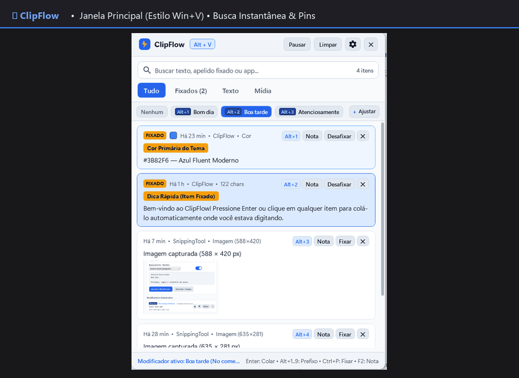
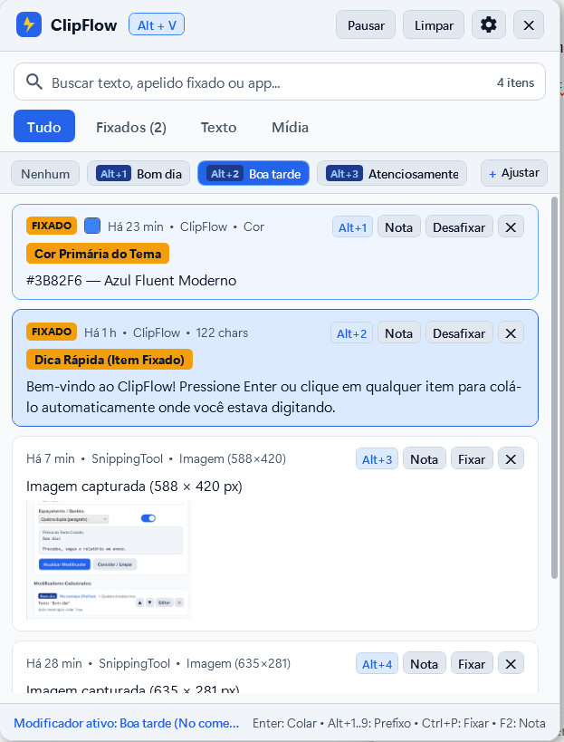
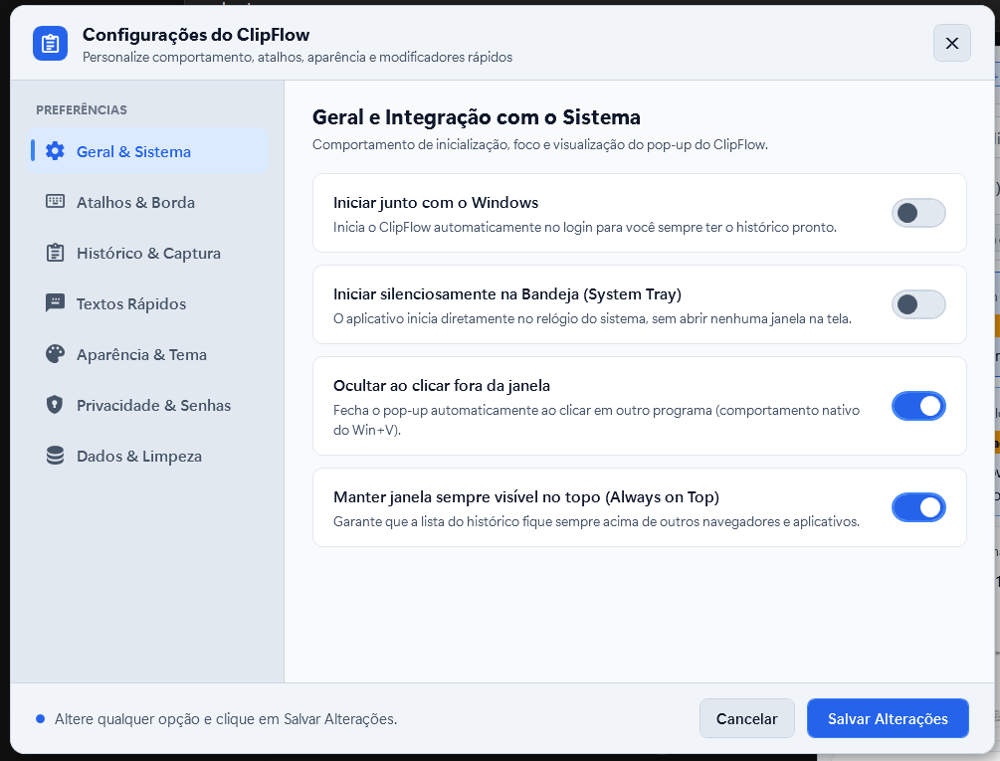
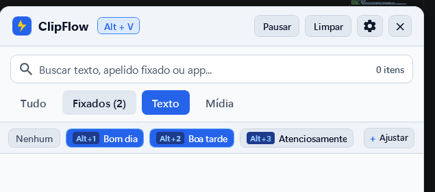
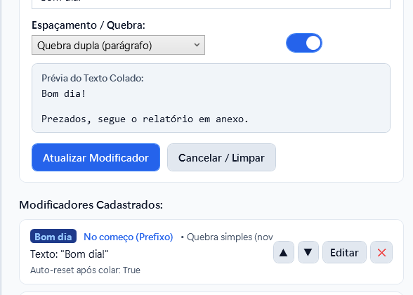

<div align="center">

# ⚡ ClipFlow
### Gerenciador de Área de Transferência Inteligente, Fluente e de Alta Velocidade para Windows

[](https://dotnet.microsoft.com/)
[](https://learn.microsoft.com/windows/apps/design/)
[](https://learn.microsoft.com/dotnet/csharp/)
[](https://microsoft.com)
[](https://github.com)

<br/>

<p align="center">
  
</p>

<p align="center">
  <b>Inspirado na agilidade do <code>Win + V</code>, mas construído para produtividade máxima: histórico ilimitado, busca em 0ms, textos rápidos (modificadores), ativação por borda e fixação com apelidos.</b>
</p>

---

</div>

## 🌟 Destaques do Projeto

* 🚀 **Abertura Instantânea:** Acione com o atalho global personalizável (`Ctrl + Shift + V`, `Alt + V`, etc.) ou apenas **encostando o mouse na borda da tela (*Edge Trigger*)**.
* 💬 **Textos Rápidos & Modificadores (`Alt + 1..9`):** Anexe saudações (*"Bom dia!"*, *"Boa tarde!"*), protocolos, assinaturas e despedidas com controle total de prefixo, sufixo, quebras de linha e auto-reset.
* 📌 **Sistema de Fixação Avançada (Pins):** Itens fixados **nunca expiram** e nunca são apagados pelo limite de histórico ou limpezas automáticas.
* 🏷️ **Apelidos e Notas Rápidas (`F2`):** Adicione um apelido aos seus itens fixados (ex.: *"PIX da Empresa"*, *"Comando Docker"*, *"Assinatura"*). A busca localiza tanto pelo apelido quanto pelo texto copiado!
* 🔍 **Busca em Tempo Real (< 5ms):** Escreva direto sem clicar; os resultados filtram instantaneamente por texto, tag, link, cor ou aplicativo de origem.
* 🎨 **Tema Claro e Escuro Dinâmico:** Alterne em tempo real entre o modo Dark e o modo Light, com acabamento nativo em **Windows 11 Fluent UI**.
* 👁️ **Renderização Cristalina:** Fontes `Segoe UI` calibradas com `ClearTypeHint` para eliminar qualquer embaçamento de tela.
* 🔒 **Privacidade & Segurança Nativas:** Bloqueio automático de gerenciadores de senhas (1Password, Bitwarden, KeePass), chaves privadas (tokens de API `sk-`, `ghp_`, `AKIA`) e lista de programas excluídos.

---

## 📸 Telas da Aplicação

<div align="center">

| Janela Flutuante Principal (Tema Escuro) | Central de Ajustes (Tema Claro) |
| :---: | :---: |
|  |  |
| *Barra de busca rápida, chips de modificadores e pins* | *7 seções com ícones vetoriais, switches e controles modernos* |

| Barra de Textos Rápidos (Alt+1..9) | Editor de Modificadores com Prévia |
| :---: | :---: |
|  |  |
| *Chips interativos com seleção e auto-reset ao colar* | *Configuração de prefixos/sufixos e pré-visualização ao vivo* |

</div>

---

## ⌨️ Mapa de Atalhos de Teclado

O ClipFlow foi arquitetado para que você nunca precise tirar as mãos do teclado:

| Atalho | Ação |
| :--- | :--- |
| **`Ctrl + Shift + V`** *(ou `Alt + V`)* | Abre / Oculta a janela flutuante do ClipFlow. |
| **`↑` / `↓`** | Navega pelos itens do histórico. |
| **`Enter`** *(ou Duplo Clique)* | **Cola imediatamente** o item no aplicativo ativo. |
| **`Shift + Enter`** | **Cola como Texto Puro** (remove formatação, cores e HTML). |
| **`Alt + 1` até `Alt + 9`** | Ativa o **Texto Rápido / Modificador** correspondente da barra de chips. |
| **`Ctrl + P`** *(ou clique no 📌)* | **Fixa / Desafixa (Pin/Unpin)** o item selecionado. |
| **`F2`** *(ou `Ctrl + E`)* | Edita o **Apelido/Nota** do item selecionado. |
| **`Tab` / `Shift + Tab`** | Alterna entre as abas: *Tudo* → *Fixados 📌* → *Texto* → *Mídia*. |
| **`Delete`** *(ou `Ctrl + D`)* | Remove o item do histórico (itens fixados solicitam confirmação). |
| **`Esc`** | Limpa a busca (se preenchida) ou fecha a janela. |
| **Digitação Direta** | Ao abrir, comece a digitar qualquer letra para pesquisar instantaneamente. |

---

## 🚀 Como Executar

### Pré-requisitos
* **Sistema Operacional:** Windows 10 (Build 19041+) ou Windows 11.
* **SDK:** [.NET 10 SDK](https://dotnet.microsoft.com/download) instalado.

### Executando em Modo Rápido:
Dê um duplo clique no script conveniente na raiz do projeto:
```bat
Abrir-ClipFlow.bat
```

### Compilando via Terminal (.NET CLI):
```powershell
# Clone o repositório
git clone https://github.com/alcidesdiogenes/clipflow.git
cd clipflow

# Restaure as dependências e compile em Release
dotnet build src/ClipFlow.App -c Release

# Execute a aplicação
dotnet run --project src/ClipFlow.App -c Release
```

---

## 📚 Documentação Técnica Completa

Explore a arquitetura e detalhes de engenharia na pasta [`docs/`](./docs):

* 📑 [**01. Análise Técnica dos Projetos de Referência**](./docs/01-analise-referencias.md) — Benchmarking com Clippboard, EcoPaste e Clip.
* 🏗️ [**02. Arquitetura do Sistema**](./docs/02-arquitetura-clipflow.md) — P/Invoke Win32, `HWND_MESSAGE`, `SendInput`, Edge Trigger e Temas.
* 💾 [**03. Modelo de Dados e Regras de Negócio**](./docs/03-modelo-dados-e-regras.md) — `ClipItem`, `TextModifierPreset`, `AppSettings` e Deduplicação SHA-256.
* 🎨 [**04. Design de Interface (UI/UX) e Atalhos**](./docs/04-ux-ui-e-atalhos.md) — Ergonomia, ClearType e diagramas de layout.
* 🗺️ [**05. Roadmap de Implementação**](./docs/05-roadmap-implementacao.md) — 5 fases completas de desenvolvimento.

---

## 📄 Licença
Distribuído sob a licença **MIT**. Veja o arquivo `LICENSE` para mais informações.
