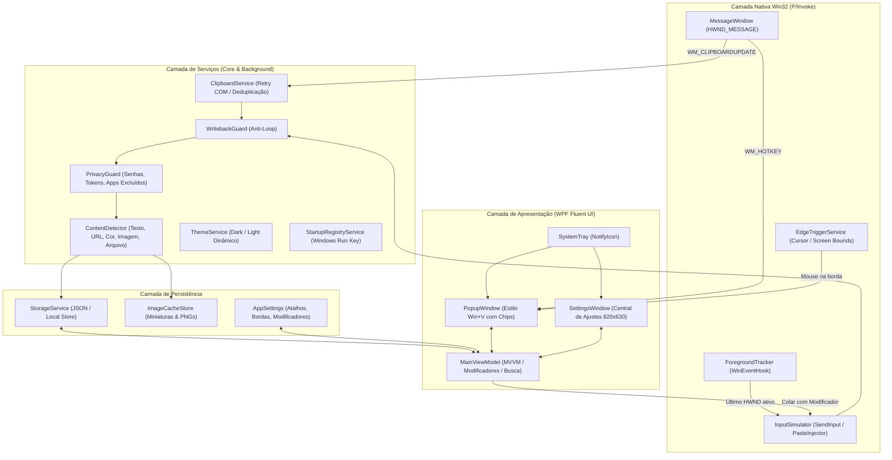

# 02. Arquitetura do Sistema — ClipFlow

Este documento especifica a arquitetura técnica do **ClipFlow**, projetada em **C# / .NET 10 (WPF)** para máxima performance nativa no Windows, consumo mínimo de memória RAM, resposta instantânea e modularidade.

---

## 1. Visão Geral da Arquitetura em Camadas



---

## 2. Estrutura de Pastas do Projeto (`ClipFlow`)

```text
clipflow/
├── docs/                               # Documentação técnica e arquitetural
├── src/
│   └── ClipFlow.App/
│       ├── ClipFlow.App.csproj         # Projeto .NET 10 WPF (net10.0-windows)
│       ├── App.xaml                    # Paleta dinâmica (Dark/Light), estilos de ScrollBar
│       ├── App.xaml.cs                 # Mutex de instância única, ciclo de vida e System Tray
│       ├── Platform/                   # Interoperabilidade Win32 e Comportamentos
│       │   ├── NativeMethods.cs        # Declarações user32.dll / kernel32.dll
│       │   ├── MessageWindow.cs        # Janela HWND_MESSAGE para escuta de mensagens do SO
│       │   ├── ForegroundTracker.cs    # Rastreamento de foco da janela de trabalho do usuário
│       │   ├── PasteInjector.cs        # Restauração de foco e simulação precisa de Ctrl+V
│       │   ├── AppIconBuilder.cs       # Gerador dinâmico de ícones em alta resolução para a janela e Tray
│       │   └── SmoothScrollBehavior.cs # Rolagem inercial suave para o ScrollViewer do WPF
│       ├── Models/                     # Entidades de domínio e configurações
│       │   ├── ClipItem.cs             # Registro de item copiado (Texto, Imagem, Arquivos, Pins)
│       │   ├── ClipKind.cs             # Enums: Kind (Text, Image, Files) e SubKind
│       │   ├── AppSettings.cs          # Modelo completo de preferências salvas
│       │   └── TextModifierPreset.cs   # Modificadores de texto rápido (Prefixos, Sufixos, Quebras)
│       ├── Services/                   # Regras de negócio e processamento
│       │   ├── ClipboardService.cs     # Captura de clipboard, deduplicação SHA-256 e retry COM
│       │   ├── EdgeTriggerService.cs   # Gatilho de abertura do app ao encostar o mouse nas laterais
│       │   ├── ThemeService.cs         # Alternância instantânea de temas Dark e Light
│       │   ├── StartupRegistryService.cs # Registro de inicialização com o Windows (HKCU Run)
│       │   ├── WritebackGuard.cs       # Prevenção de loop quando o ClipFlow cola no app alvo
│       │   ├── ContentDetector.cs      # Classificação inteligente de URLs, cores Hex, e-mails e código
│       │   ├── PrivacyGuard.cs         # Filtro de gerenciadores de senhas, chaves privadas e apps excluídos
│       │   └── StorageService.cs       # Persistência atômica em disco (%LOCALAPPDATA%/ClipFlow)
│       ├── ViewModels/                 # Estado reativo e lógica de apresentação (MVVM)
│       │   └── MainViewModel.cs        # Coleções filtradas, pins, modificadores e comandos
│       └── Views/                      # Interfaces visuais WPF
│           ├── PopupWindow.xaml        # Janela flutuante estilo Win+V com barra de chips de modificadores
│           ├── PopupWindow.xaml.cs     # Posicionamento inteligente, docking lateral e atalhos rápidos
│           ├── SettingsWindow.xaml     # Central de Ajustes 820x630 (Fluent UI com 7 seções)
│           └── SettingsWindow.xaml.cs  # Gerenciamento de preferências, editor de modificadores e ações
└── ClipFlow.sln                        # Solução Visual Studio / .NET CLI
```

---

## 3. Especificação dos Módulos Críticos (Win32 Interop & Core)

### 3.1. Escuta de Área de Transferência (`MessageWindow` + `ClipboardService`)
* **Mensagem do Windows:** `WM_CLIPBOARDUPDATE = 0x031D`.
* **Registro:** `AddClipboardFormatListener(hwnd)` conectado a uma janela oculta `HWND_MESSAGE` (`new nint(-3)`).
* **Resiliência a Bloqueios COM (`CLIPBRD_E_CANT_OPEN`):**
  * Ao receber `0x031D`, o serviço lê `GetClipboardSequenceNumber()`.
  * Inicia um timer com até 8 tentativas de leitura espaçadas (`DispatcherTimer` de `60ms` a `80ms`) para ler `Clipboard.GetDataObject()` sem travar a interface gráfica caso outro processo esteja finalizando a escrita.

### 3.2. Atalho Global (`RegisterHotKey`)
* **Mensagem do Windows:** `WM_HOTKEY = 0x0312`.
* **Atalho Padrão:** `Ctrl + Shift + V` ou `Alt + V` (configurável, com flag `MOD_NOREPEAT = 0x4000`).
* **Comportamento Toggle:**
  * Se o `PopupWindow` estiver oculto: captura a posição do mouse/tela, atualiza a lista, abre a janela e foca na barra de pesquisa.
  * Se já estiver visível: oculta imediatamente e devolve o foco para a janela anterior.

### 3.3. Rastreamento de Foco (`ForegroundTracker`)
* **Hook:** `SetWinEventHook(EVENT_SYSTEM_FOREGROUND = 3, ..., WINEVENT_OUTOFCONTEXT = 2)`.
* **Filtro de Janelas Ignoradas:**
  * Ignora o processo do próprio ClipFlow (`Environment.ProcessId`).
  * Ignora janelas do sistema operacional: `Shell_TrayWnd`, `Shell_SecondaryTrayWnd`, `NotifyIconOverflowWindow`, `#32768` (menus de contexto).
* **Propósito:** A propriedade `LastWindow` sempre guarda o ponteiro `HWND` real do aplicativo onde o usuário estava digitando (ex.: Google Chrome, VS Code, Word, Discord).

### 3.4. Motor de Injeção de Colagem (`PasteInjector`)
Quando o usuário seleciona um item no ClipFlow (via `Enter` ou duplo clique):
1. **Aplicação de Modificador Ativo:** Se houver um chip de texto rápido selecionado (ex: "Bom dia"), o `MainViewModel` aplica `TextModifierPreset.Apply()` antes de injetar o conteúdo.
2. **Writeback Guard:** Registra o hash no `WritebackGuard` para ignorar o evento de clipboard disparado pela própria cópia.
3. **Escrita no Clipboard:** Atualiza o clipboard do sistema (como texto puro se o usuário usou `Shift + Enter` ou conforme configurado).
4. **Ocultação e Restauração de Foco:** Oculta a janela e restaura o foco via `SetForegroundWindow(LastWindow)`.
5. **Simulação Atômica (`SendInput`):** Dispara `Ctrl + V` e opcionalmente reseta o modificador ativo se `AutoReset = true`.

### 3.5. Gatilho por Borda da Tela (`EdgeTriggerService`)
* Monitora o ponteiro do mouse via timer de alta precisão (`40ms`).
* Ao detectar o cursor no pixel `0` (borda esquerda) ou no pixel final da largura da tela (borda direita) por um tempo contínuo pré-definido (sensibilidade padrão: `220ms`):
  * Abre o ClipFlow automaticamente e o acopla (*docking*) diretamente na borda ativada.
  * Possui período de graça (*grace period*) e estabilização de clique externo para evitar fechamentos indesejados.

### 3.6. Sistema Dinâmico de Temas (`ThemeService`)
* Altera as propriedades de cores (`WindowBgBrush`, `CardBgBrush`, `PrimaryTextBrush`, etc.) diretamente no `ResourceDictionary` global em tempo de execução.
* Suporta **Tema Escuro (Dark)** e **Tema Claro (Light)**, garantindo contraste adequado e legibilidade em qualquer ambiente.

### 3.7. Otimização de Nitidez de Fontes (ClearType no WPF)
* Janelas WPF com `AllowsTransparency="True"` desativam a renderização subpixel ClearType por padrão, utilizando suavização em tons de cinza (*grayscale smoothing*).
* O ClipFlow resolve isso ativando:
  * `RenderOptions.ClearTypeHint="Enabled"` na camada opaca do fundo.
  * `TextOptions.TextFormattingMode="Display"`.
  * `TextOptions.TextHintingMode="Fixed"`.
  * Família tipográfica padrão do sistema: `Segoe UI, Segoe UI Variable Text`.

---

## 4. Instância Única e Inicialização Silenciosa
* O `App.xaml.cs` utiliza um `Mutex` global nomeado (`Local\ClipFlow_SingleInstance_Mutex`).
* Se uma segunda instância for iniciada, a primeira recebe o foco automaticamente em vez de criar um processo duplicado.
