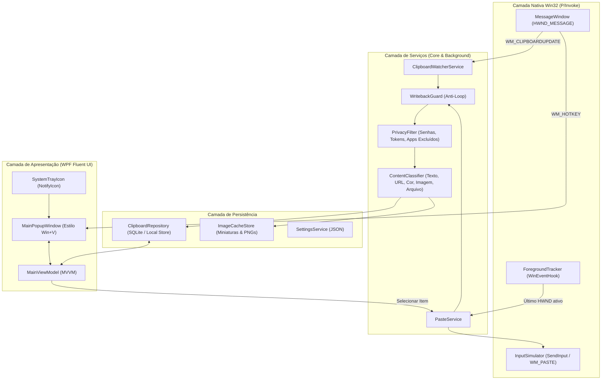

# 02. Arquitetura do Sistema — ClipFlow

Este documento especifica a arquitetura técnica do **ClipFlow**, projetada em **C# / .NET 10 (WPF)** para máxima performance nativa no Windows, consumo mínimo de memória RAM e resposta instantânea.

---

## 1. Visão Geral da Arquitetura em Camadas



---

## 2. Estrutura de Pastas do Projeto (`ClipFlow`)

```text
clipflow/
├── docs/                               # Documentação técnica e arquitetural
├── src/
│   └── ClipFlow.App/
│       ├── ClipFlow.App.csproj         # Projeto .NET 10 WPF (net10.0-windows)
│       ├── App.xaml                    # Recursos globais, tema Dark/Fluent
│       ├── App.xaml.cs                 # Ciclo de vida, instância única (Mutex), Tray
│       ├── Platform/                   # Interoperabilidade Win32 (P/Invoke)
│       │   ├── NativeMethods.cs        # Declarações user32.dll / kernel32.dll
│       │   ├── MessageWindow.cs        # HWND_MESSAGE para escuta invisível
│       │   ├── ForegroundTracker.cs    # Rastreamento da janela ativa do usuário
│       │   └── PasteInjector.cs        # Restauração de foco e simulação Ctrl+V
│       ├── Models/                     # Entidades de domínio
│       │   ├── ClipItem.cs             # Item do histórico (Texto, Imagem, Arquivo)
│       │   ├── ClipKind.cs             # Enums: Kind (Text, Image, Files) e SubKind
│       │   └── AppSettings.cs          # Configurações (Atalho, Limite, Exclusões)
│       ├── Services/                   # Regras de negócio e processamento
│       │   ├── ClipboardService.cs     # Captura, retry COM, deduplicação
│       │   ├── WritebackGuard.cs       # Prevenção de loop ao colar
│       │   ├── ContentDetector.cs      # Detecção de URL, Cor Hex, Email, Código
│       │   ├── PrivacyGuard.cs         # Filtro de senhas e apps ignorados
│       │   └── StorageService.cs       # Persistência rápida e gerenciamento de Pins
│       ├── ViewModels/                 # Estado reativo da interface (MVVM)
│       │   └── MainViewModel.cs        # Busca instantânea, abas (Todos/Fixados), comandos
│       └── Views/                      # Interfaces visuais WPF
│           ├── PopupWindow.xaml        # Janela flutuante estilo Win+V
│           └── SettingsWindow.xaml     # Configurações de atalho e limites
└── ClipFlow.sln                        # Solução Visual Studio / .NET CLI
```

---

## 3. Especificação dos Módulos Críticos (Win32 Interop)

### 3.1. Escuta de Área de Transferência (`MessageWindow` + `ClipboardService`)
* **Mensagem do Windows:** `WM_CLIPBOARDUPDATE = 0x031D`.
* **Registro:** `AddClipboardFormatListener(hwnd)` conectado a uma janela `HWND_MESSAGE` (`new nint(-3)`).
* **Resiliência a Bloqueios COM (`CLIPBRD_E_CANT_OPEN`):**
  * Ao receber `0x031D`, o serviço lê `GetClipboardSequenceNumber()`.
  * Inicia um `DispatcherTimer` de `60ms` a `80ms` (máximo 8 tentativas) para ler o `Clipboard.GetDataObject()` sem travar a UI caso outro app ainda esteja fechando o handle da área de transferência.

### 3.2. Atalho Global (`RegisterHotKey`)
* **Mensagem do Windows:** `WM_HOTKEY = 0x0312`.
* **Atalho Padrão:** `Ctrl + Shift + V` ou `Alt + V` (configurável pelo usuário, com flag `MOD_NOREPEAT = 0x4000`).
* **Comportamento Toggle:**
  * Se o `PopupWindow` estiver oculto: captura a posição do mouse/tela, atualiza o filtro, exibe a janela e foca na barra de pesquisa/lista.
  * Se o `PopupWindow` já estiver visível: oculta a janela e devolve o foco ao aplicativo anterior.

### 3.3. Rastreamento de Foco (`ForegroundTracker`)
* **Hook:** `SetWinEventHook(EVENT_SYSTEM_FOREGROUND = 3, ..., WINEVENT_OUTOFCONTEXT = 2)`.
* **Filtro de Janelas Ignoradas:**
  * Ignora o próprio processo (`Environment.ProcessId`).
  * Ignora classes do Explorer/Bandeja: `Shell_TrayWnd`, `Shell_SecondaryTrayWnd`, `NotifyIconOverflowWindow`, `#32768` (menus de contexto).
* **Resultado:** A propriedade `LastWindow` sempre contém o `HWND` real onde o usuário estava trabalhando (ex.: VS Code, Chrome, Word, Discord).

### 3.4. Motor de Colagem Automática (`PasteInjector`)
Quando o usuário seleciona um item no ClipFlow (via `Enter`, clique ou atalho `1..9`):
1. **Writeback Guard:** Registra o hash/sequência do item no `WritebackGuard` para que o ClipFlow saiba que a próxima alteração do clipboard veio dele mesmo.
2. **Escrita no Clipboard:** Define o conteúdo selecionado no Clipboard do Windows (com opção de manter formatação ou colar como Texto Puro se `Shift + Enter` foi usado).
3. **Ocultação:** Esconde o `PopupWindow` imediatamente (`Hide()`).
4. **Restauração de Foco:** Chama `SetForegroundWindow(LastWindow)` e aguarda `15ms–25ms` para a janela de destino ativar sua fila de entrada.
5. **Disparo de Teclas (`SendInput`):** Envia o pacote atômico de 4 eventos de teclado:
   * `VK_CONTROL (0x11)` KeyDown
   * `VK_V (0x56)` KeyDown
   * `VK_V (0x56)` KeyUp
   * `VK_CONTROL (0x11)` KeyUp
6. **Atualização de Uso:** Incrementa `UseCount` do item e atualiza `LastUsedAt`.

---

## 4. Instância Única e Inicialização Silenciosa
* O `App.xaml.cs` utiliza um `Mutex` global nomeado (`Local\ClipFlow_SingleInstance_Mutex`).
* Se o usuário tentar abrir o executável uma segunda vez, a primeira instância recebe um sinal para exibir o `PopupWindow` na tela em vez de duplicar o processo em segundo plano.
